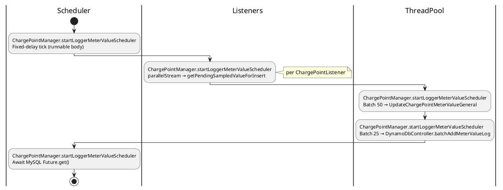
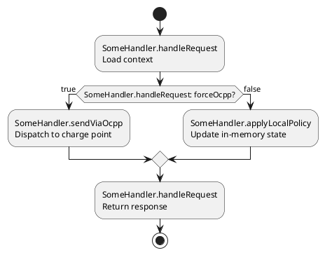
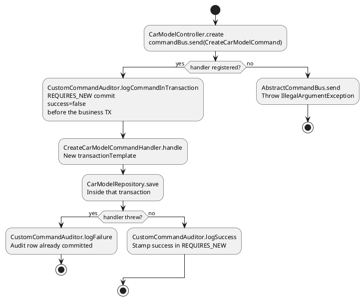

# Examples — tool--plantuml-activity-tree

## Example A — Scheduler / batch job

**User says:** "Explain how meter values get flushed in ChargePointManager."

**Agent assumes:** Entry = scheduler runnable inside `startLoggerMeterValueScheduler` (or user-provided method).

**Outline (abbreviated):**

1. `ChargePointManager.startLoggerMeterValueScheduler` — scheduler runnable body: fixed-delay tick fires (`async`, `Scheduler`).
2. `ChargePointManager.startLoggerMeterValueScheduler` — `parallelStream` collect pending values from listeners (`shared-mutable`).
3. `ChargePointManager.startLoggerMeterValueScheduler` — batch sublists of 50; `ThreadPool.submitCallable(UpdateChargePointMeterValueGeneral)` (`async`, `DB`).
4. `ChargePointManager.startLoggerMeterValueScheduler` — batch sublists of 25; `DynamoDbController.batchAddMeterValueLog` (`async`, `external`).
5. `ChargePointManager.startLoggerMeterValueScheduler` — `Future.get()` on MySQL batches (`blocking`).

**Activity snippet (illustrative):**



## Example A2 — Decision diamond (boolean flag)

**User says:** "Show when we force OCPP vs local path."



Use **`(yes)` / `(no)`** instead when the condition is not a boolean literal style check.

## Example B — Command bus (default activity tree)

**User says:** "Diagram CreateCarModel from controller to DB."

**Entry:** `commandBus.send(CreateCarModelCommand)`.

Draw a **top-down activity tree**, not a sequence. Each box is `ClassName.methodName`. Diamonds are the outcome branches (handler missing, nested vs new transaction, handler threw). A repository save is an action on the trunk, not a participant.



## Example C — User prompt (minimal)

```text
Entry: POST /api/admin/car-models → through command handler.

tool--plantuml-activity-tree: top-down activity tree, max 12 nodes.
Every action: ClassName.methodName plus a short action.
Outcome branches as yes/no diamonds. Happy path continues down.
Never a sequence diagram unless this prompt says "sequence diagram". Exclude validation boilerplate.
```
