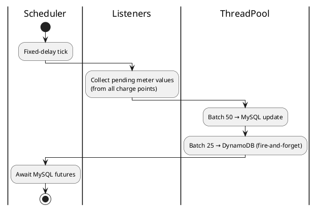

# Examples — tool--plantuml-flow-digest

## Example A — Scheduler / batch job

**User says:** "Explain how meter values get flushed in ChargePointManager."

**Agent assumes:** Entry = scheduler runnable inside `startLoggerMeterValueScheduler` (or user-provided method).

**Outline (abbreviated):**

1. Scheduler fires on fixed delay (`async`, `Scheduler`).
2. Parallel collect pending sampled values from all listeners (`shared-mutable` read from listeners).
3. Split into batches of 50 → submit callable to thread pool (`async`, `DB`).
4. Split into batches of 25 → Dynamo batch write (`async`, `external`).
5. Wait on futures (`blocking`).

**Activity snippet (illustrative):**



## Example B — Command bus (web.v2 style)

**User says:** "Diagram CreateCarModel from controller to DB."

**Entry:** `commandBus.send(CreateCarModelCommand)`.

**Sequence participants:** `Controller`, `CommandBus`, `Handler`, `Repository`, `EventQueue`, `Listeners`.

**Notes in diagram:** save inside transaction; `eventQueue.add` before commit; listeners run before commit unless documented otherwise.

## Example C — User prompt (minimal)

```text
Entry: POST /api/admin/car-models → through command handler.

tool--plantuml-flow-digest: sequence diagram, max 12 messages.
Swimlanes not needed; partition "Command transaction".
Exclude validation boilerplate.
```
