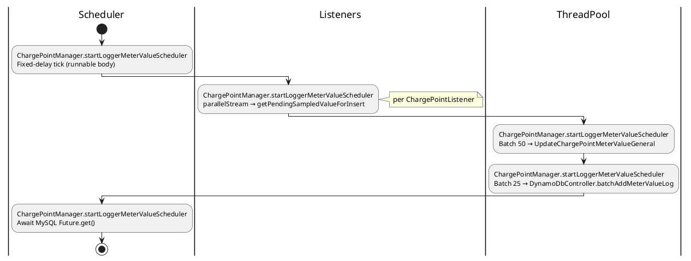
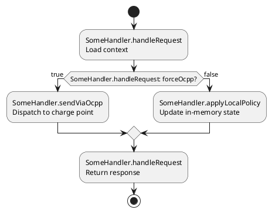

# Examples — tool--plantuml-flow-digest

## Example A — Scheduler / batch job

**User says:** "Explain how meter values get flushed in ChargePointManager."

**Agent assumes:** Entry = scheduler runnable inside `startLoggerMeterValueScheduler` (or user-provided method).

**Outline (abbreviated):**

1. `ChargePointManager.startLoggerMeterValueScheduler` — scheduler runnable body: fixed-delay tick fires (`async`, `Scheduler`).
2. `ChargePointManager.startLoggerMeterValueScheduler` — `parallelStream` collect pending values from listeners (`shared-mutable`).
3. `ChargePointManager.startLoggerMeterValueScheduler` — batch sublists of 50; `ThreadPool.submitCallable(UpdateChargePointMeterValueGeneral)` (`async`, `DB`).
4. `ChargePointManager.startLoggerMeterValueScheduler` — batch sublists of 25; `DynamoDbController.batchAddMeterValueLog` (`async`, `external`).
5. `ChargePointManager.startLoggerMeterValueScheduler` — `Future.get()` on MySQL batches (`blocking`).

**Activity snippet (illustrative):**



## Example A2 — Decision diamond (boolean flag)

**User says:** "Show when we force OCPP vs local path."



Use **`(yes)` / `(no)`** instead when the condition is not a boolean literal style check.

## Example B — Command bus (web.v2 style)

**User says:** "Diagram CreateCarModel from controller to DB."

**Entry:** `commandBus.send(CreateCarModelCommand)`.

**Sequence participants:** `CarModelController`, `CommandBus`, `CreateCarModelCommandHandler`, `CarModelRepository`, `EventQueue`, listeners.

**Arrow labels (examples):** `CarModelController.create()` → `CommandBus.send()` → `CreateCarModelCommandHandler.handle()` → `CarModelRepository.save()` → `EventQueue.add(CarModelCreatedEvent)`.

**Notes in diagram:** save inside transaction; listeners run before commit unless documented otherwise.

## Example C — User prompt (minimal)

```text
Entry: POST /api/admin/car-models → through command handler.

tool--plantuml-flow-digest: sequence diagram, max 12 messages.
Every message labeled ClassName.methodName (or method on participant).
Swimlanes not needed; partition "Command transaction".
Exclude validation boilerplate.
```
